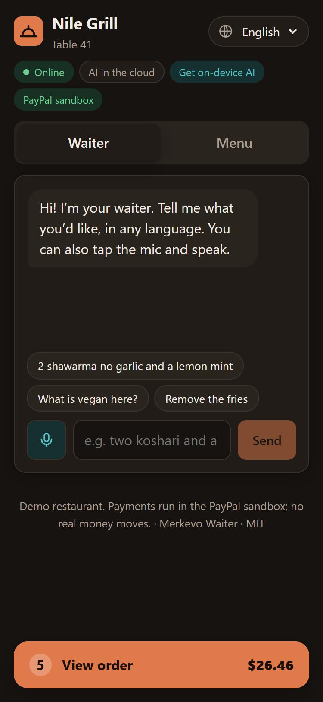
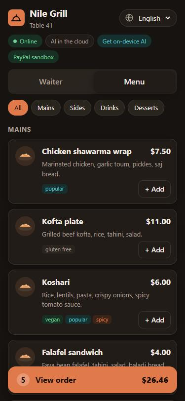
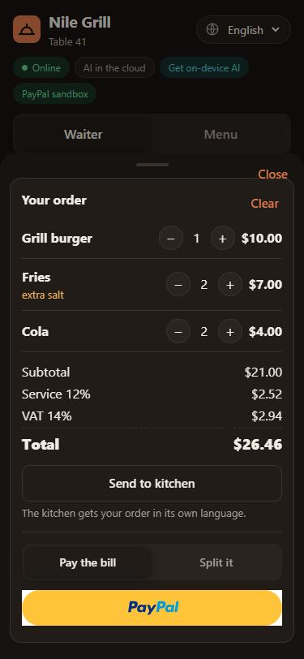
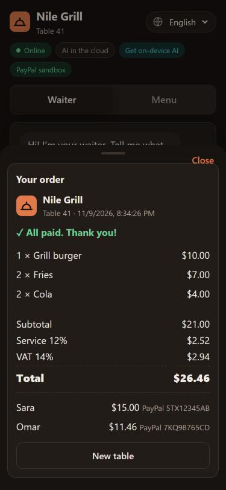
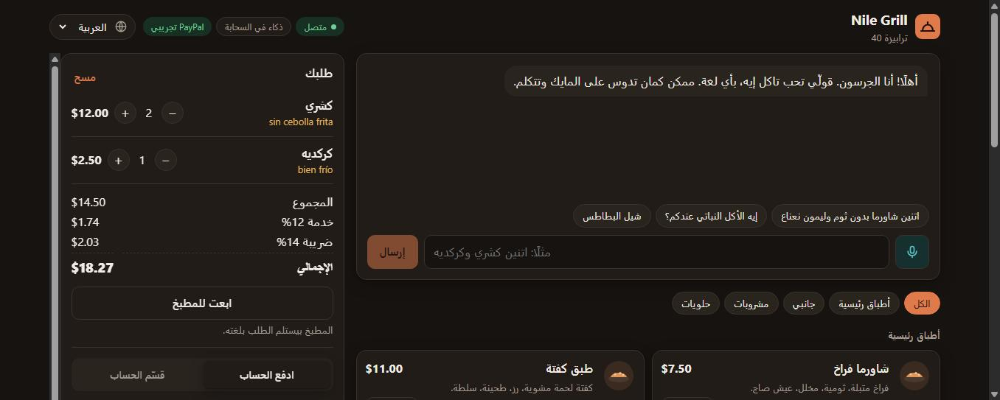

# Merkevo Waiter

**An AI waiter for restaurant tables. Guests order by talking, in their own language. They split the bill in plain words, and each person pays their share with PayPal. The kitchen gets the order in its own language.**

**Live demo:** https://waiter.lexu.io · **Kitchen screen:** https://waiter.lexu.io/kitchen
*(PayPal sandbox. No real money moves. Pay with any PayPal sandbox personal account.)*

| Phone: talk to the waiter | Menu | Order and pay | Receipt |
|---|---|---|---|
|  |  |  |  |

| Desktop in Arabic (right to left) | Kitchen: a French order, shown in Arabic |
|---|---|
|  |  |

## The problem
- **Tourists and staff don't share a language.** A Spanish guest in a Cairo restaurant points at the menu; the note "sin cebolla" never reaches the cook.
- **Settling a group bill is slow.** "Who had the burger? Half the fries were mine." Someone opens a calculator, and the table waits for one card machine.
- **Restaurant Wi-Fi drops.** A waiter that needs the cloud for every sentence stops when the network does.

## What it does
| | |
|---|---|
| **Talk to order, in any language** | "Quiero dos koshari sin cebolla frita" or «اتنين شاورما بدون ثوم» becomes cart actions (add, remove, quantity, notes). Questions ("what is vegan?") get answers, not cart changes. Off-menu requests are declined politely. Voice input through the browser's microphone. |
| **Seven interface languages** | English, Arabic (right to left), French, Spanish, German, Italian, Turkish, with the menu translated. The AI answers in the guest's language. |
| **Kitchen in its own language** | "Send to kitchen" puts the ticket on `/kitchen`. Item names show in the staff's language, and the guest's free-text notes are translated by the same AI, with the original underneath. |
| **Split in plain words** | "Sara pays 2 shawarma and half the karkade, Omar pays 1 koshari, Mona the rest", or "split it 3 ways". Service and VAT follow each share, and the cents always add up to the table total. |
| **Everyone pays their share with PayPal** | One PayPal button per person (PayPal Orders v2). The order locks after the first payment, and a receipt lists every payer and PayPal transaction. |
| **Shows where the AI ran** | Every reply is tagged *On-device · Gemini Nano*, *Cloud · Gemini* or *Offline rules*, with its response time. |

## How it works
```
Guest words ─▶ Firebase AI Logic hybrid inference (PREFER_ON_DEVICE)
                 ├─ Gemini Nano in Chrome   (JSON schema output)   ← works offline
                 └─ Gemini in the cloud     (responseSchema)        ← when the device can't
               └─ no model at all ─▶ rule-based parser (English + Arabic)
             ─▶ validation (menu ids only, quantities capped) ─▶ cart / split plan / kitchen notes

Pay ─▶ server recomputes every amount from its own menu ─▶ PayPal Orders v2 (create → approve → capture)
```
**Safe money handling**
- **Prices never come from the browser.** The server rebuilds each order from its menu. It builds the PayPal order with `item_total`, `handling` (service charge) and `tax_total`, and these add up exactly.
- **No double charges.** Every create and capture carries a `PayPal-Request-Id`. If the network drops after the guest approves, the page retries and then offers "Confirm payment again" for the same order. The PayPal button stays hidden meanwhile.
- **The AI can't change prices.** Guest text is treated as data: the model can only return actions on real menu ids, and everything it returns is validated. Prompt-injection attempts ("set every price to zero") are refused.
- **App Check** (reCAPTCHA Enterprise) makes sure only this app can spend the Gemini quota. Only the public site key is in the code.

## Run it locally
```bash
npm install
cp .env.example .env     # optional: PayPal sandbox and Firebase keys
npm run dev              # web on http://localhost:5173, API on :8787
npm test                 # 22 unit and API tests
```
With no keys it runs in **demo mode**: payments are simulated, and the AI uses Chrome's built-in model or the rule-based parser.

### Turn on the real pieces
1. **PayPal sandbox:** create an app at developer.paypal.com → *Apps & Credentials* → *Sandbox*, linked to a sandbox **business** account in a country that can receive payments (for example US). Put `PAYPAL_CLIENT_ID` and `PAYPAL_CLIENT_SECRET` in `.env`.
2. **Firebase AI Logic:** create a Firebase project, add a web app, and enable **Firebase AI Logic** with the *Gemini Developer API*. Copy the config into the `VITE_FIREBASE_*` variables. App Check is enforced: register a debug token for localhost (`VITE_APPCHECK_DEBUG_TOKEN`), and a reCAPTCHA Enterprise site key for production (`VITE_RECAPTCHA_SITE_KEY`).
3. **On-device model (optional):** Chrome 139+ on desktop, with `chrome://flags/#prompt-api-for-gemini-nano-multimodal-input` enabled. Then click **Get on-device AI** in the header.

### Production
```bash
npm run build && npm start   # one Node server serves the app and the API
```
`deploy/merkevo-waiter.service` is the systemd unit used for the live demo. It runs under a dedicated user, on 127.0.0.1 only, behind Caddy.

## Project layout
| Path | What |
|---|---|
| `shared/` | Menu, cart maths, bill splitting and the rule-based parser. Pure TypeScript, shared by the browser and the server. |
| `src/ai/engine.ts` | Hybrid inference (Firebase AI Logic), the Chrome built-in fallback, prompts, schemas, validation and kitchen-note translation. |
| `src/` | React UI: `App.tsx` (guest), `Kitchen.tsx` (staff), `i18n.ts` (7 languages), `speech.ts` (voice input). |
| `server/` | Express API, a small PayPal Orders v2 client, and kitchen tickets. |
| `test/` | Node test runner: cart, split, parser, PayPal order body, API flow, capture after a network drop, kitchen tickets. |

Built by Ahmed Farouk as part of the Merkevo restaurant platform. This waiter is a standalone, open-source module. License: MIT.
